## UNIVERSIDAD DE SAN CARLOS DE GUATEMALA

### FACULTAD DE INGENIERÍA

#### MANEJO E IMPLEMENTACION DE ARCHIVOS

#### CATEDRÁTICO: Ing. JURGEN ANDONI RAMIREZ RAMIREZ

#### TUTOR ACADÉMICO: JUAN FRANCISCO URBINA SILVA

#### Angel José Cardenas Pocón

#### CARNÉ: 202304063

#### SECCIÓN: A

#### Guatemala, 21 de diciembre del 2025

# Manual Tecnico

# Intrudoccion
El presente Manual Técnico documenta el diseño, implementación y funcionamiento interno de ExtreamFS, una aplicación web multiplataforma desarrollada para simular y administrar un sistema de archivos basado en EXT2. El proyecto surge como una solución práctica para comprender las estructuras fundamentales de los sistemas de archivos reales, tales como discos, particiones, inodos, bloques y permisos, sin depender de hardware físico, mediante el uso de archivos binarios con extensión .mia.

La aplicación integra un backend desarrollado en Go (Golang) que expone servicios mediante APIs REST, y un frontend interactivo que permite la ejecución de comandos, la gestión de usuarios y la visualización de reportes estructurales generados con Graphviz. Este manual está dirigido a desarrolladores, evaluadores y personal técnico que necesiten comprender la arquitectura del sistema, las estructuras de datos implementadas y el comportamiento de los comandos soportados.

El objetivo de este documento es servir como una guía clara y detallada que facilite la comprensión, mantenimiento y posible extensión del sistema de archivos EXT2 simulado dentro de la aplicación web.

# Objetivos

- Objetivo General

Documentar de manera clara y estructurada la arquitectura, las estructuras de datos y los comandos implementados en la aplicación web ExtreamFS, con el fin de proporcionar una referencia técnica que permita comprender, mantener y validar el funcionamiento del sistema de archivos EXT2 simulado desarrollado en Go.

- Objetivos Específicos

Describir la arquitectura del sistema, detallando la interacción entre el frontend y el backend, así como el uso de APIs para la ejecución de comandos y visualización de resultados. 

Explicar las estructuras de datos fundamentales del sistema de archivos EXT2, incluyendo el MBR, particiones, inodos y bloques, y su organización dentro del archivo binario .mia. 

Documentar los comandos implementados para la administración de discos, particiones, usuarios, archivos y carpetas (como mkdisk, fdisk, mount, mkfs, mkfile, mkdir, cat, entre otros), indicando su sintaxis, parámetros y efectos sobre el sistema. 

Detallar el proceso de generación de reportes visuales mediante Graphviz, utilizados para representar estructuras como el MBR, inodos, bloques y el árbol del sistema de archivos. 

Proporcionar una guía técnica que sirva como apoyo para la verificación de funcionalidades, mantenimiento del sistema y futuras ampliaciones del proyecto. 

# Requisitos

### Requisitos de Hardware

Procesador: mínimo 1.5 GHz (recomendado 2.0 GHz o superior).

Memoria RAM: 2 GB mínimo (recomendado 4 GB o superior).

Almacenamiento: 2 GB de espacio disponible.

Pantalla: resolución mínima 1024x768.

### Requisitos de Software

Sistema Operativo: Linux (distribución libre) o Windows 10.

Lenguaje de programación: Go.

IDE compatible: Visual Studio Code.

Herramienta para gráficos y reportes: Graphviz.

## Logica del programa

En este apartado explicaremos de manera técnica lo que contiene cada archivo Go que se creo para el proyecto.

### Backend

1. disk_utils.go (pkg/utils)
Contiene funciones utilitarias para operaciones comunes del sistema de archivos:

ConvertToBytes: Convierte tamaños de K/M a bytes
GenerateRandomSignature: Crea un identificador único para cada disco
GetFitByte: Convierte estrategias de ajuste (BF/FF/WF) a byte
ByteToString/StringToBytes: Conversión entre arrays de bytes y strings
CreateDirectory/FileExists: Operaciones básicas de archivos
WriteStruct/ReadStruct: Serialización de estructuras en archivos binarios
GeneratePartitionID: Genera IDs únicos para particiones montadas (formato: últimos 2 dígitos del carnet + número de partición + letra del disco)
ParseCommand: Analiza comandos con parámetros (ej: mkdisk -size=10 -unit=M)
CalculateEXT2Structures: Calcula número de inodos y bloques según el tamaño de la partición

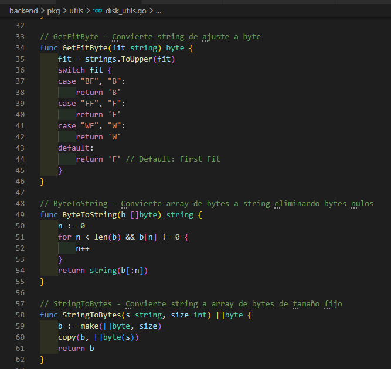

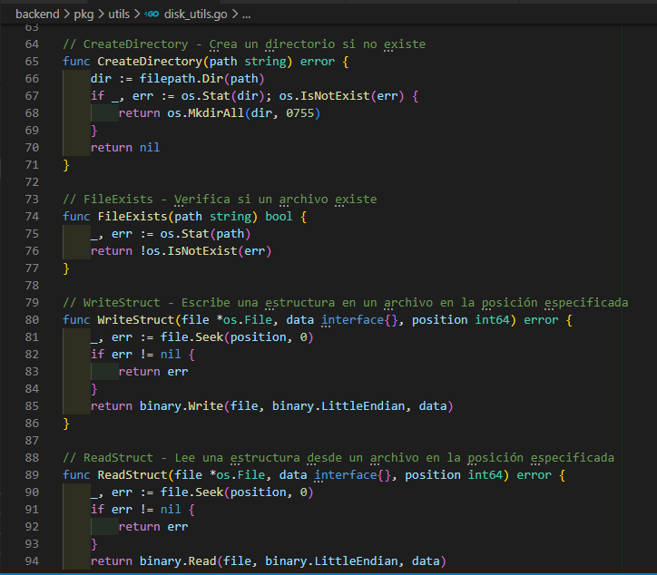

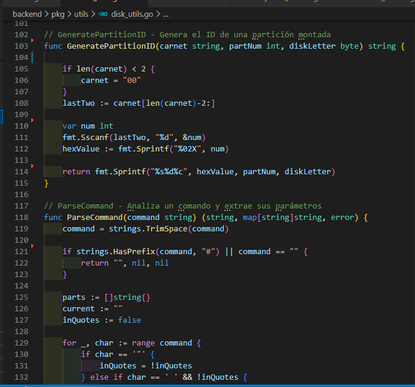
2. disk_service.go (pkg/services)
Gestiona la creación y eliminación de discos virtuales:

MKDISK: Crea archivos .mia con nomenclatura automática (VDIC-A.mia, VDIC-B.mia, etc.)
Inicializa el MBR (Master Boot Record)
Llena el disco con ceros
Registra el disco en un mapa interno
RMDISK: Elimina discos virtuales del sistema
LoadExistingDisks: Carga discos .mia existentes al iniciar
Mantiene un mapa de discos creados para gestionar letras disponibles

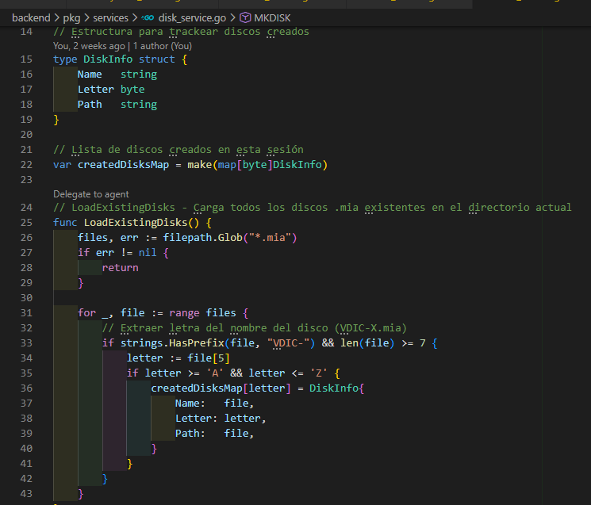

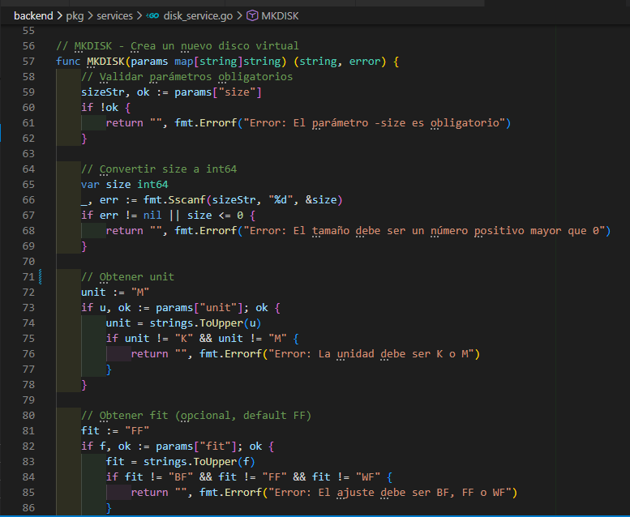
3. partition_service.go (pkg/services)
Administra particiones primarias, extendidas y lógicas:

FDISK: Comando principal para crear particiones
createPrimaryPartition: Crea particiones primarias (máximo 4 por disco)
createExtendedPartition: Crea una partición extendida (solo 1 permitida)
createLogicalPartition: Crea particiones lógicas dentro de la extendida usando EBRs
findSpace: Implementa estrategias de ajuste (Best Fit, First Fit, Worst Fit) para encontrar espacio disponible en el disco
Valida límites y nombres duplicados de particiones

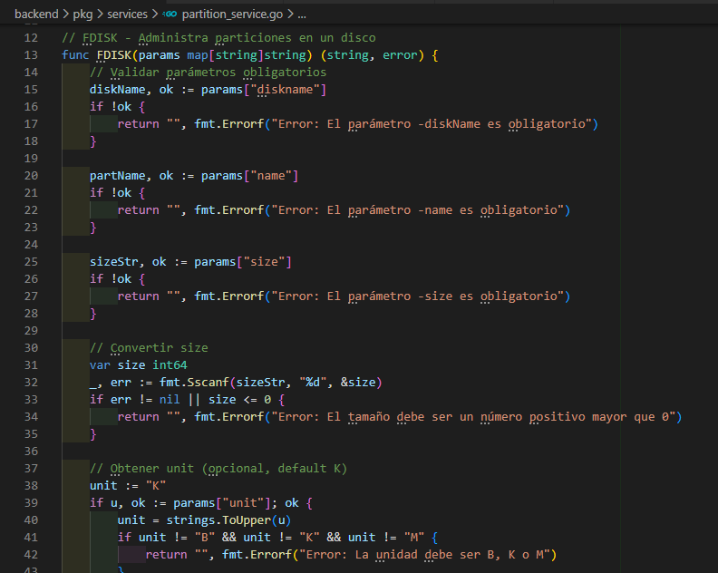

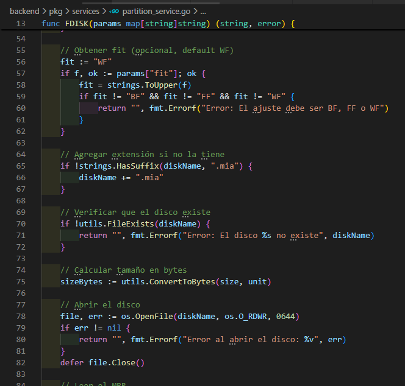
4. mount_service.go (pkg/services)
Gestiona el montaje de particiones:

MOUNT: Monta una partición y le asigna un ID único
Actualiza el MBR con el estado de montaje
Genera IDs basados en el carnet (últimos 2 dígitos en hexadecimal)
Mantiene contador de particiones por disco
MOUNTED: Lista todas las particiones montadas actualmente
GetMountedPartition: Obtiene información de una partición montada por ID
UnmountPartition: Desmonta una partición
Mantiene un mapa global de particiones montadas

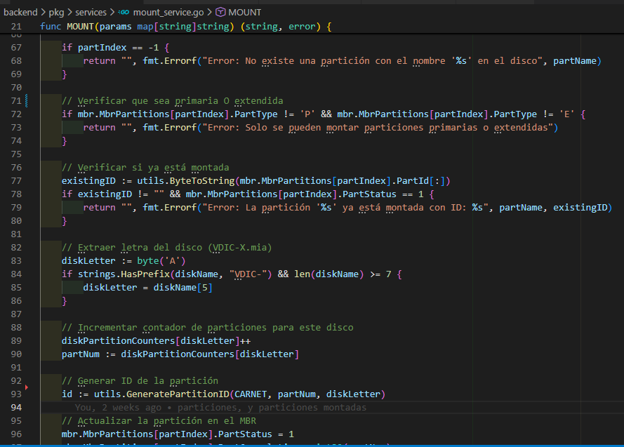

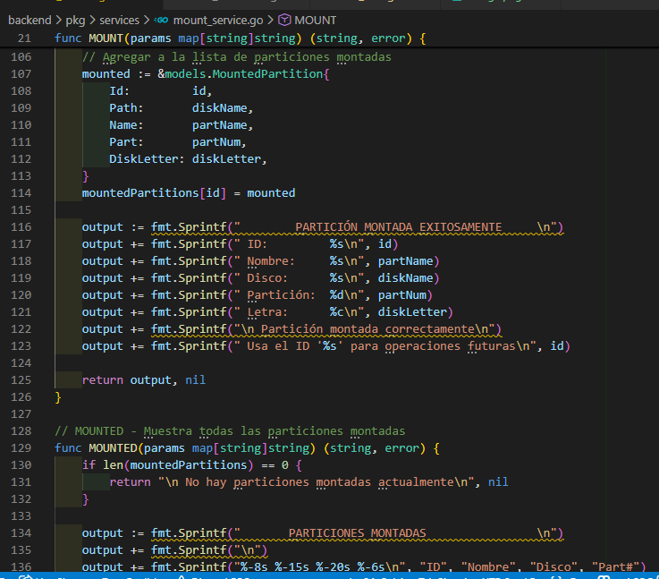
5. filesystem_service.go (pkg/services)
Implementa el formateo con sistema de archivos EXT2:

MKFS: Formatea una partición montada
Crea el Superbloque con metadata del sistema
Inicializa bitmaps de inodos y bloques
Crea el inodo raíz (directorio /)
Crea el archivo users.txt con usuario root por defecto
Calcula estructuras basándose en el tamaño de la partición
Establece la estructura completa del sistema de archivos EXT2

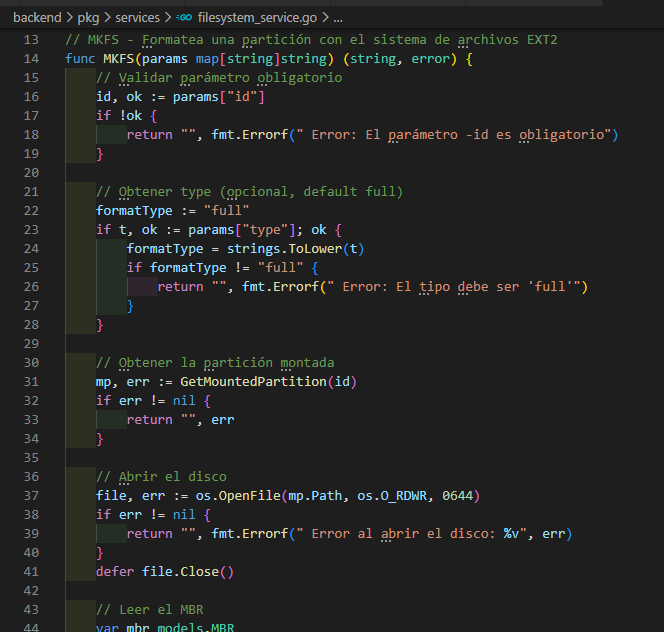

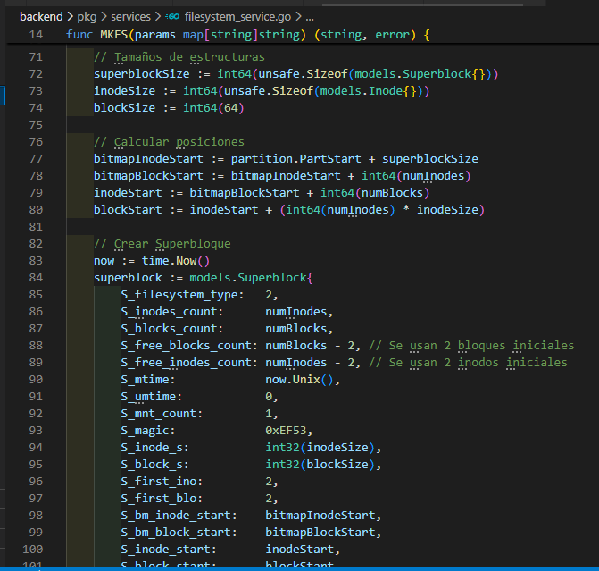

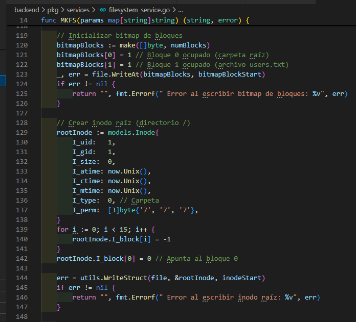
6. file_service.go (pkg/services)
Gestiona archivos y directorios dentro del sistema EXT2:

MKFILE: Crea archivos con contenido opcional
Soporta -cont para contenido desde archivo externo
Soporta -size para archivos vacíos de tamaño fijo
Opción -p para crear directorios padres
MKDIR: Crea directorios con opción recursiva
CAT: Muestra contenido de uno o múltiples archivos
Funciones auxiliares:
findInodeByPath: Navega por la ruta para encontrar inodos
findFreeInode/Block: Busca espacios libres en bitmaps
addEntryToDirectory: Agrega entradas en bloques de carpeta
Manejo de bloques directos del sistema EXT2

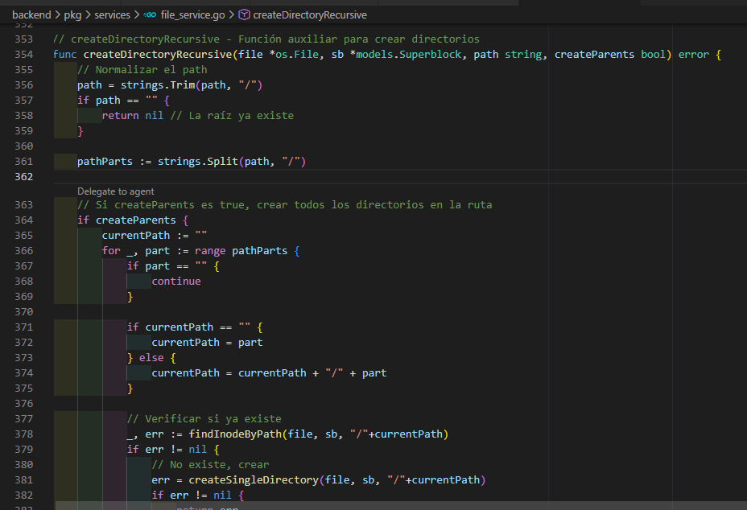
7. user_service.go (pkg/services)
Administra usuarios y grupos del sistema:

MKGRP: Crea grupos (solo root)
Asigna GID automáticamente
Verifica que no exista el grupo
Actualiza users.txt
MKUSR: Crea usuarios (solo root)
Asigna UID automáticamente
Valida que el grupo exista
Formato: UID,U,GID,usuario,contraseña
Lee y escribe en el archivo users.txt del sistema EXT2
Solo el usuario root puede ejecutar estos comandos
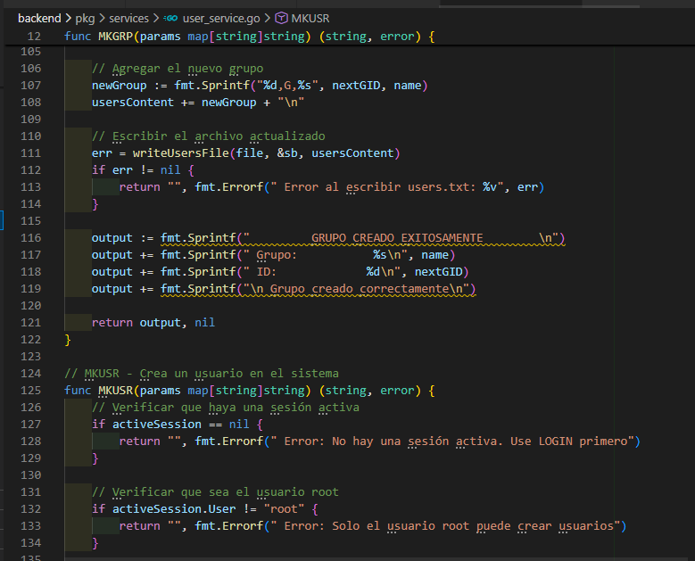

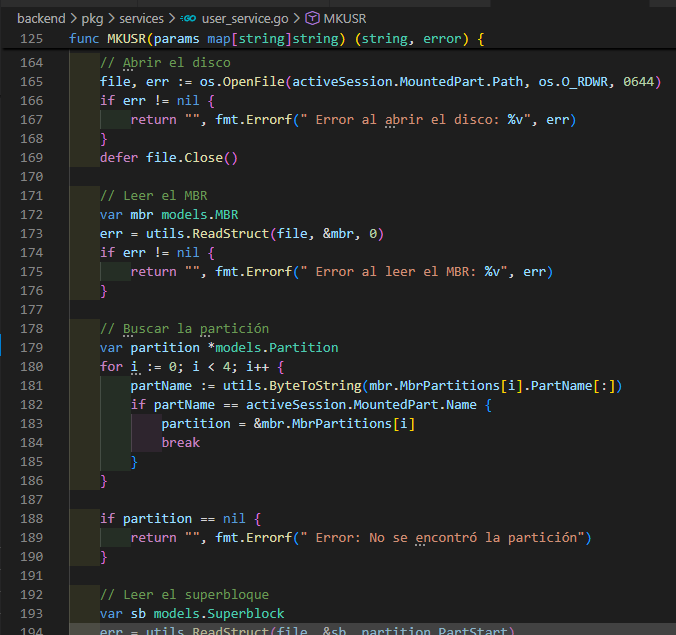
8. auth_service.go (pkg/services)
Gestiona la autenticación y sesiones:

LOGIN: Inicia sesión en una partición montada
Valida credenciales contra users.txt
Crea una sesión global (activeSession)
Solo permite una sesión activa a la vez
LOGOUT: Cierra la sesión activa
readUsersFile/writeUsersFile: Lee y escribe el archivo users.txt desde el sistema EXT2
GetActiveSession: Obtiene la sesión actual
La sesión almacena: usuario, UID, GID, partición montada

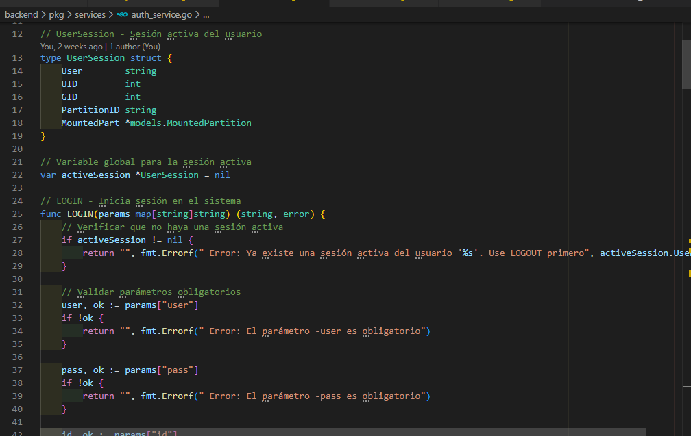
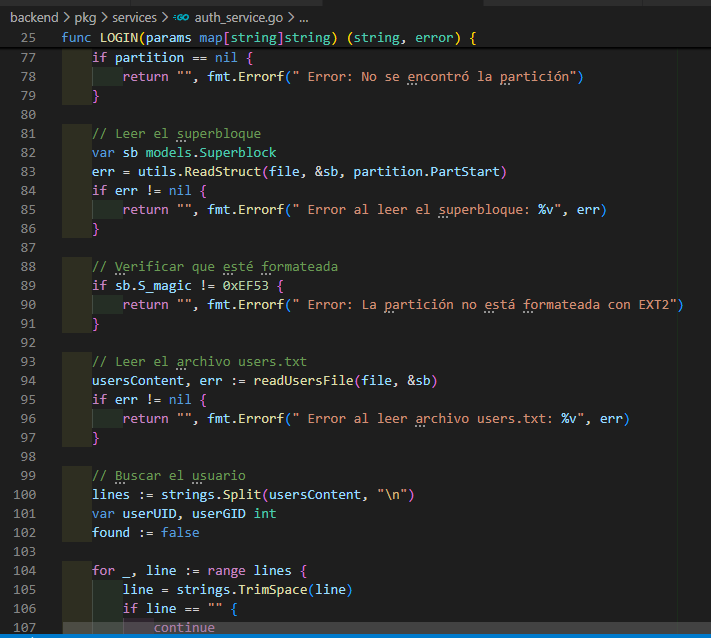
## Flujo General del Sistema
MKDISK → Crea disco virtual
FDISK → Crea particiones (P/E/L)
MOUNT → Monta la partición
MKFS → Formatea con EXT2
LOGIN → Inicia sesión (root o usuario creado)
MKGRP/MKUSR → Administra usuarios (solo root)
MKDIR/MKFILE/CAT → Opera con archivos

## Fronted

1. index.html
Punto de entrada HTML de la aplicación:

Define la estructura HTML básica
Contiene un 
 donde se monta la aplicación React
Carga el script main.jsx como módulo ES6
Incluye el favicon (/R.jpg)
Título: "MIA" (Manejo e Implementación de Archivos)

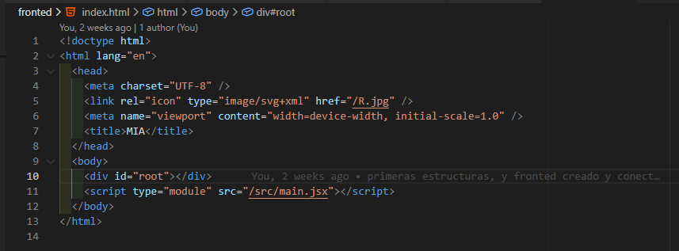
2. main.jsx
Punto de entrada de React:

Importa React y el componente principal App
Usa createRoot (React 18+) para montar la aplicación
Envuelve <App /> en <StrictMode> para detectar problemas potenciales
Renderiza la aplicación en el elemento #root
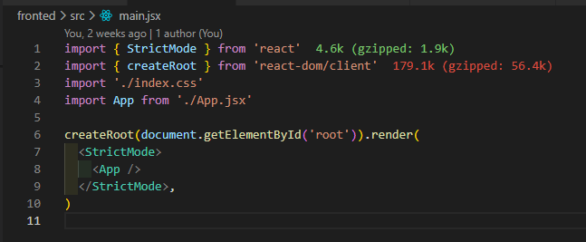
3. App.jsx
Componente principal de la interfaz:

Configuración:
API_URL: http://localhost:8080 (servidor backend Go)
Usa axios para comunicación HTTP con el backend
Estados (useState):
inputCommands: Almacena los comandos escritos o cargados
outputCommands: Muestra resultados de ejecución
loading: Controla el estado de carga durante ejecución
fileName: Nombre del archivo cargado (.smia)

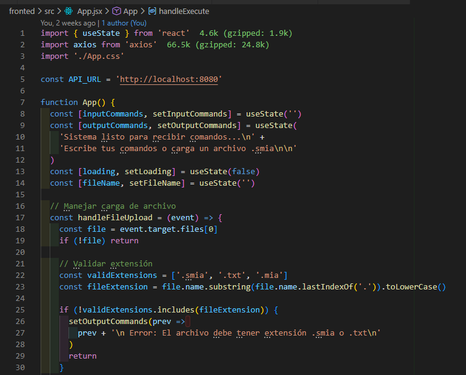

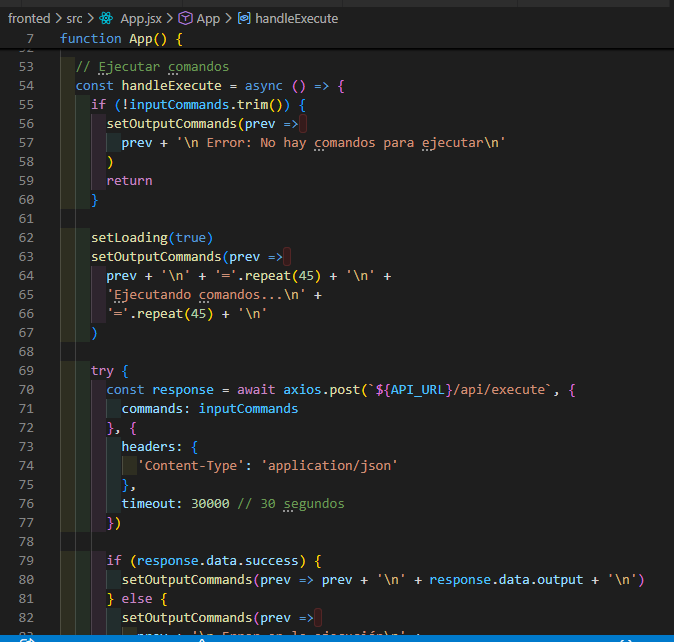

#### Tecnologías Frontend:
React 18+: Framework de UI
Vite: Build tool ultra rápido
Axios: Cliente HTTP para API calls
CSS Modules: Estilos (App.css, index.css)
ES6+: JavaScript moderno