## UNIVERSIDAD DE SAN CARLOS DE GUATEMALA

### FACULTAD DE INGENIERÍA

#### MANEJO E IMPLEMENTACION DE ARCHIVOS

#### CATEDRÁTICO: Ing. JURGEN ANDONI RAMIREZ RAMÍREZ

#### TUTOR ACADÉMICO: JUAN FRANCISCO URBINA SILVA

#### Angel José Cardenas Pocón

#### CARNÉ: 202304063

#### SECCIÓN: A

#### Guatemala, 21 de diciembre del 2025

## Manual de Usuario

## 1. Introducción

GoDisk es una aplicación web diseñada para simular el funcionamiento interno de un sistema de archivos EXT2. Su finalidad es permitir al usuario crear, administrar y manipular discos virtuales mediante una interfaz gráfica moderna y un conjunto de comandos que representan el comportamiento real de un sistema operativo.

## 2. Objetivos del Sistema

### 2.1 Objetivo General

Ofrecer un entorno web funcional que permita simular un sistema de archivos EXT2, administrar discos virtuales y ejecutar comandos que manipulen particiones, directorios, archivos y usuarios, proporcionando retroalimentación textual y visual al usuario.

### 2.2 Objetivos Específicos

Permitir la creación, eliminación y administración de discos virtuales (.mia) y de las particiones contenidas en ellos.

Ofrecer un área para ejecutar comandos y cargar scripts que automaticen acciones sobre el sistema simulado.

Administrar usuarios, grupos, permisos, archivos y directorios, según las reglas del sistema EXT2.

Generar reportes visuales con Graphviz sobre las estructuras internas del disco y del sistema de archivos.

Simular de forma fiel la lógica del sistema de archivos EXT2 mediante su estructura interna real.

## 3. Información del Sistema

ExtreamFS opera mediante dos componentes principales: el frontend y el backend.

### 3.1 Frontend

Desarrollado con Angular, React o Vue.js.

Componentes principales:

Área de Entrada de Comandos: donde se escriben instrucciones o se cargan scripts .smia.

Botón “Cargar Script”: inserta el contenido del archivo dentro del área de texto.

Botón “Ejecutar”: envía todas las instrucciones al backend.

Área de Salida: muestra resultados, errores y reportes generados.

### 3.2 Backend

Desarrollado en Golang.

Funciones principales:

Manipulación de discos virtuales (.mia).

Creación y administración de particiones primarias, extendidas y lógicas.

Implementación del sistema de archivos EXT2 (superbloque, bitmaps, inodos, bloques).

Sistema de usuarios, grupos y permisos.

Ejecución de comandos completos.

Generación de reportes utilizando Graphviz.

## 4. Requisitos del Sistema

### 4.1 Requisitos de Software

Sistema operativo:

GNU/Linux (obligatorio para calificación).

Compatible con MacOS para desarrollo.

Golang 1.20 o superior.

NodeJS + NPM (si el frontend usa Angular/React).

Graphviz instalado.

Navegador moderno (Chrome, Edge o Firefox).

### 4.2 Requisitos de Hardware

4 GB RAM (mínimo).

1 GB de espacio disponible.

Procesador 64 bits.

### 4.3 Requisitos del Usuario

Conocer los comandos del proyecto.

Entender rutas absolutas en sistemas de archivos.

Conocer permisos UGO.

Saber interpretar reportes generados por Graphviz.

## 5. Flujo del Sistema para el Usuario

A continuación se describe el flujo general que sigue un usuario dentro de ExtreamFS, desde la apertura de la aplicación hasta la ejecución de operaciones completas.

5.1 Inicio y preparación

El usuario abre la aplicación web.

Observa:

Área para escribir comandos.

Botones para cargar y ejecutar scripts.

Área donde se imprimirá la salida.
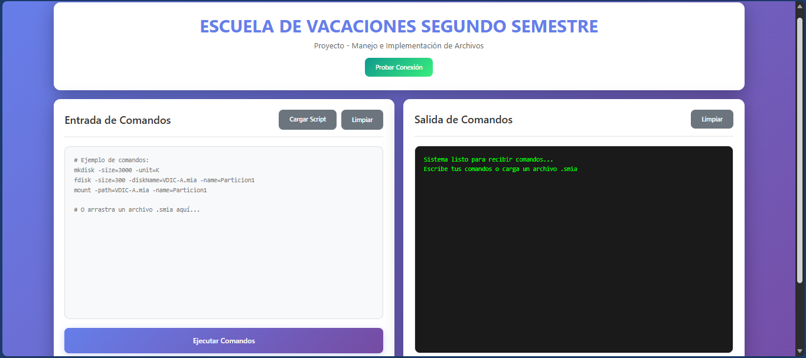

5.2 Gestión de discos

Crear un disco (.mia)

Comando:
mkdisk -size=3000 -unit=K

Eliminar un disco (si es necesario):

rmdisk -diskName="VDIC-A.mia"
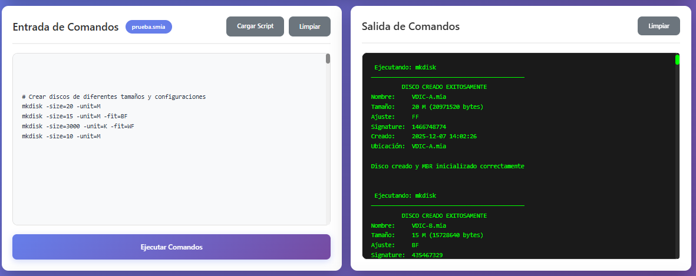
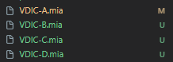

5.3 Administración de particiones

Crear particiones primarias, extendidas o lógicas:

fdisk -size=300 -unit=K -diskName=VDIC-A.mia -name=Part1

Validar restricciones del modelo de particiones.

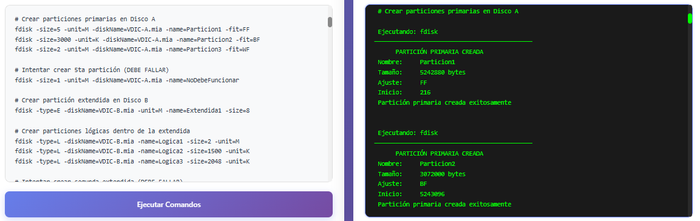

5.4 Montaje de particiones

Montar:

mount -path=VDIC-A.mia -name=Part1

Observar la generación automática del ID.

Consultar particiones montadas:

mounted
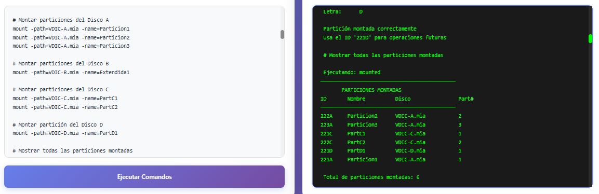

5.5 Formateo EXT2

Crear el sistema EXT2 dentro de la partición montada:

mkfs -id=221A

El sistema genera:

Superbloque

Bitmaps

Inodos

Bloques

users.txt inicial (root)

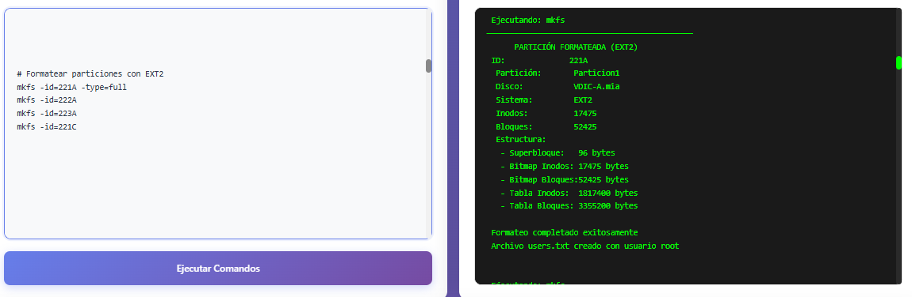

5.6 Administración de usuarios

Iniciar sesión:
login -user=root -pass=123 -id=221A

Crear grupos:
mkgrp -name=administradores

Crear usuarios:
mkusr -user=juan -pass=123 -grp=administradores

Cerrar sesión:
logout

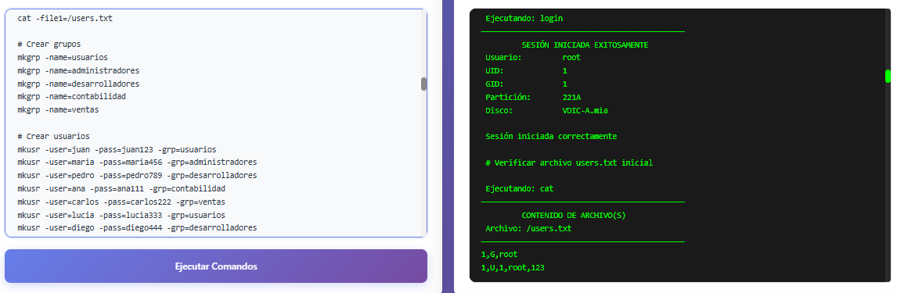

5.7 Manipulación de carpetas y archivos

Crear carpetas:
mkdir -path=/home/user/docs -p

Crear archivos:
mkfile -path=/home/user/docs/a.txt -size=20 -r

Visualizar contenido:
cat -file1=/home/user/docs/a.txt

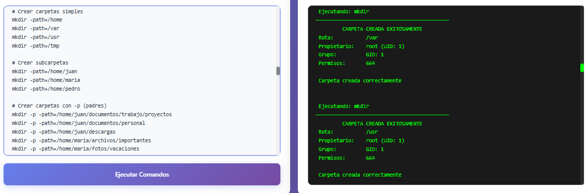

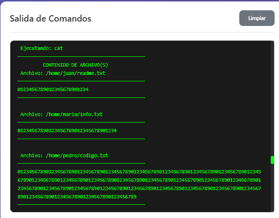
5.8 Generación de reportes

El usuario puede generar cualquier reporte:

rep -id=221A -name=inode -path=/reportes/inodos.jpg

rep -id=221A -name=tree -path=/reportes/arbol.jpg

rep -id=221A -name=bm_inode -path=/reportes/bits.txt

Los reportes se guardan en la ruta especificada y pueden ser visualizados o descargados desde la aplicación.

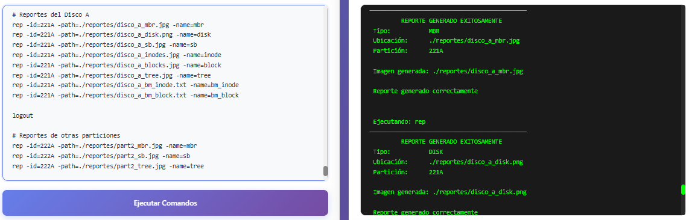

5.9 Ejecución de scripts

El usuario selecciona un archivo .smia.

El sistema carga todos los comandos en el área de entrada.

El usuario presiona “Ejecutar”.

La salida de todos los comandos se muestra secuencialmente.

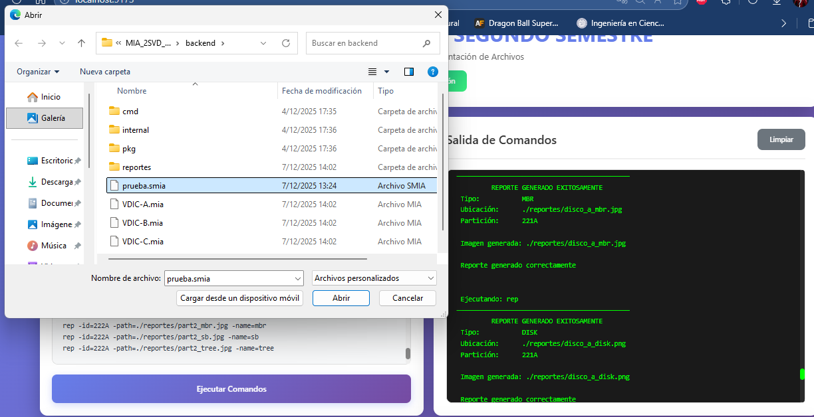

